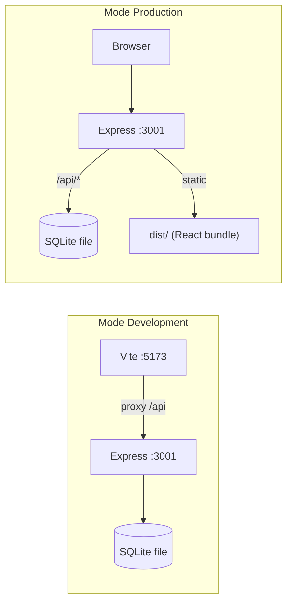
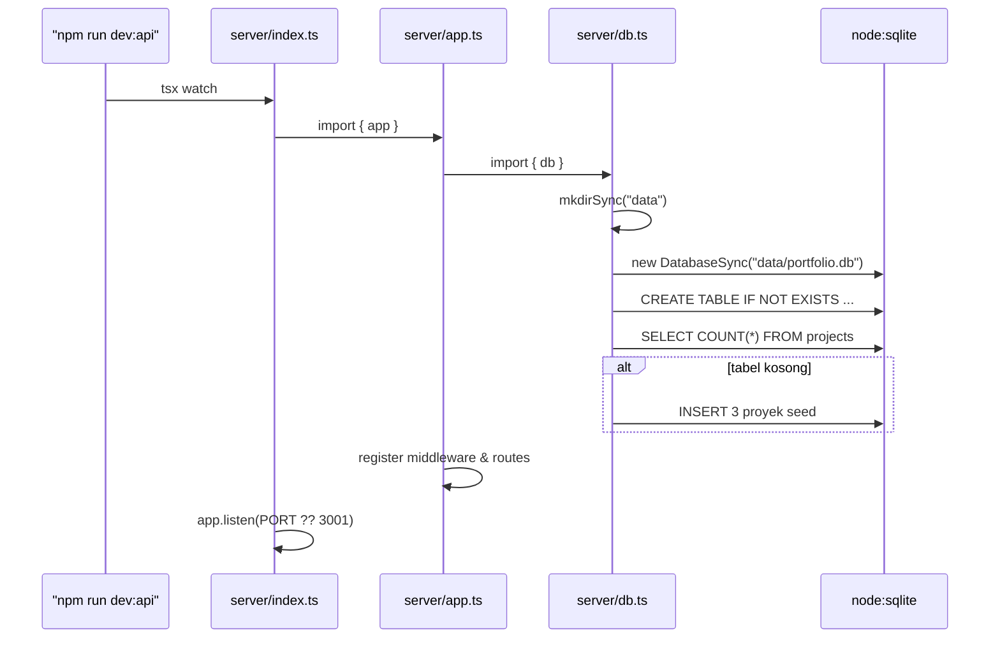
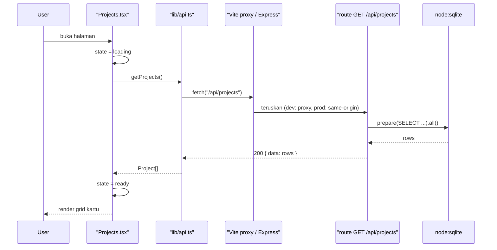
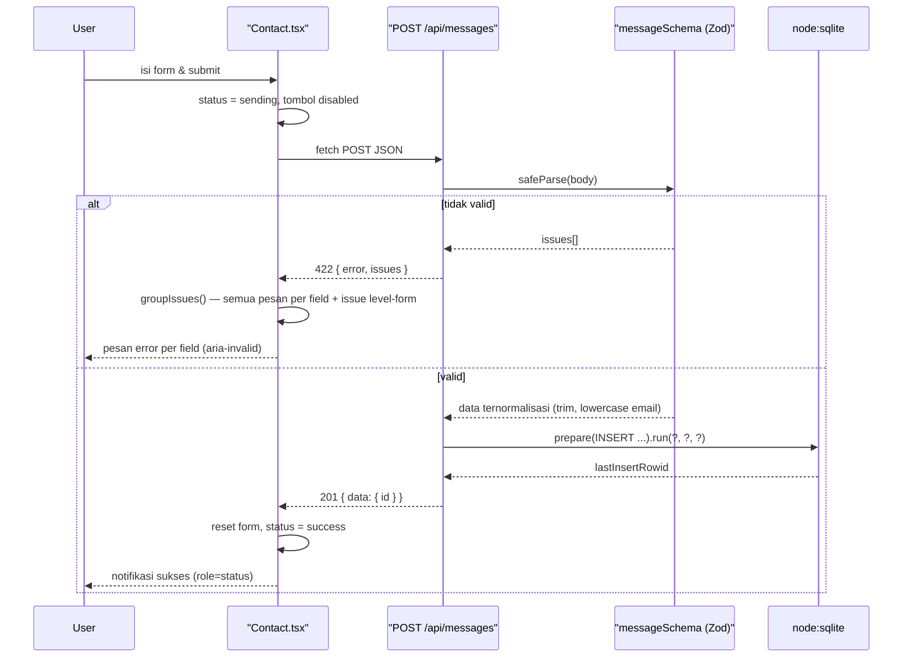
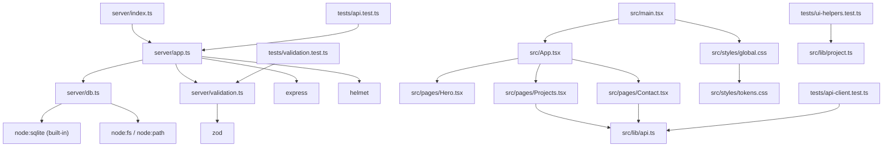

# Architecture Notes

> **Status:** Hasil analisis aktual codebase (bukan rencana).
> **Terakhir diperbarui:** 2026-11-11
> **Cara verifikasi:** `npm run typecheck` (bersih), `npm test` (37/37 PASS), `npm run build` (sukses), smoke test endpoint produksi (lulus).

---

## 1. Tech Stack, Versi Utama, dan Package Manager

**Package manager:** `npm` (dengan `package-lock.json`; tidak ada lockfile lain).

| Layer | Teknologi | Versi terpasang |
| --- | --- | --- |
| Bahasa | TypeScript (strict) | 5.9.3 |
| Runtime | Node.js | **≥ 22.5.0** (wajib; diuji pada v24.21.0) |
| Frontend | React + React DOM | 19.3.1 |
| Bundler / dev server | Vite | 8.3.8 |
| Plugin React untuk Vite | `@vitejs/plugin-react` | 6.3.0 |
| Backend | Express | 5.3.0 |
| Security headers | Helmet | 8.3.0 |
| Validasi skema | Zod | 4.6.7 |
| Database | **`node:sqlite`** (modul bawaan Node) | Bawaan runtime — 0 dependency |
| Test runner | Vitest | 5.1.0 |
| HTTP assertion | Supertest | 7.3.2 |
| Menjalankan TS di server | tsx | 4.23.15 |

**Catatan penting:** constraint `node >= 22.5.0` bukan preferensi gaya, melainkan **syarat teknis** karena `server/db.ts` mengimpor `node:sqlite`. Menurunkan versi Node akan merusak aplikasi.

**Tidak ada:** ORM (Prisma/Drizzle), CSS framework (Tailwind/Bootstrap), library routing (React Router), state manager (Redux/Zustand), library CORS.

---

## 2. Pola Arsitektur dan Fungsi Tiap Folder

### 2.1 Pola arsitektur

**Single-process, layered, same-origin.** Satu server Express melayani dua hal:

1. API JSON pada prefix `/api/*`
2. Bundle React statis dari `dist/` (otomatis bila folder `dist/` sudah ada)

Konsekuensi desain: **tidak ada CORS** (dev memakai proxy Vite; produksi same-origin), satu perintah deploy, satu port.

### 2.2 Fungsi tiap folder

| Path | Fungsi |
| --- | --- |
| `server/` | Backend Express: konfigurasi app, routing, validasi, akses database |
| `src/` | Frontend React: entry, komponen halaman, klien API, style |
| `src/pages/` | Satu file per section halaman (`Hero`, `Projects`, `Contact`) |
| `src/components/` | Komponen UI yang dapat dipakai ulang (**saat ini kosong** — belum ada komponen bersama) |
| `src/lib/` | Modul non-React: klien HTTP (`api.ts`) dan helper murni (`project.ts`) — mudah diuji tanpa DOM |
| `src/styles/` | `tokens.css` (design tokens) + `global.css` (semua styling) |
| `tests/` | Unit + integration test (Vitest), 4 file |
| `.github/` | Konfigurasi GitHub Copilot: instructions, instructions spesifik, reusable prompts |
| `data/` | Dibuat otomatis saat runtime; berisi `portfolio.db` (**di-gitignore**) |
| `dist/` | Output `vite build` (**di-gitignore**) |

### 2.3 Detail `server/`

| File | Tanggung jawab |
| --- | --- |
| `server/index.ts` | Entry: baca `PORT`, `app.listen()` |
| `server/app.ts` | Instansiasi Express, `helmet()`, `express.json({ limit: "10kb" })`, seluruh route, static serving, 404 handler, error handler |
| `server/validation.ts` | Skema Zod: `messageSchema`, `projectIdSchema` + tipe turunan |
| `server/db.ts` | Buka koneksi `DatabaseSync`, `CREATE TABLE IF NOT EXISTS`, seed 3 proyek |

Pemisahan `app.ts` dari `index.ts` **disengaja**: Supertest dapat mengimpor `app` tanpa membuka port.

---

## 3. Entry Point dan Alur Eksekusi Data

### 3.1 Entry point

| Konteks | Entry point |
| --- | --- |
| Frontend | [`index.html`](./index.html) → [`src/main.tsx`](./src/main.tsx) → `createRoot().render(<App />)` |
| Backend | [`server/index.ts`](./server/index.ts) → `app.listen(3001)` |
| Test | [`vite.config.ts`](./vite.config.ts) `test.include` → `tests/**/*.test.ts` |

### 3.2 Alur eksekusi — boot server

### 3.3 Alur data hulu → hilir: menampilkan daftar proyek

### 3.4 Alur data: mengirim pesan kontak (hulu → hilir)

    Catatan: `fetch` di `src/lib/api.ts` memakai `AbortSignal.timeout(10_000)` agar status `sending` tidak menggantung, dan respons 2xx yang bukan JSON dianggap `HttpError` alih-alih `TypeError`.

### 3.5 Titik keamanan pada alur

| Lapis | Kontrol | Lokasi |
| --- | --- | --- |
| Transport header | `helmet()` (CSP, `nosniff`, `frame-ancestors`) | `server/app.ts` |
| Ukuran payload | `express.json({ limit: "10kb" })` | `server/app.ts` |
| Validasi tipe & format | Zod `safeParse` (bukan `parse`, agar tidak melempar); email divalidasi per-label sehingga `a@b..com`/`a@b.com.` ditolak | `server/validation.ts` |
| Normalisasi | `trim()`, `toLowerCase()` pada email | `server/validation.ts` |
| ID kanonik | `projectIdSchema` hanya menerima digit murni (`0x1f`, `1e3`, `+5` → `400`) dan membatasi safe integer | `server/validation.ts` |
| Injeksi SQL | `db.prepare(...)` dengan placeholder `?` — tidak ada string concatenation | `server/app.ts` |
| Kebocoran error | Error body-parser dipetakan per `type` (`413` terlalu besar, `415` charset/encoding, `400` JSON rusak); hanya fault server yang di-`console.error` + `500` generik | `server/app.ts` |

---

## 4. Modul/File Paling Krusial Beserta Dependensinya

### 4.1 Peringkat krusialitas

| # | File | Mengapa krusial | Dependensi |
| --- | --- | --- | --- |
| 1 | [`server/db.ts`](./server/db.ts) | Satu-satunya jalur ke data; membuat skema + seed. Jika gagal, seluruh API gagal | `node:sqlite`, `node:fs`, `node:path` |
| 2 | [`server/app.ts`](./server/app.ts) | Seluruh kontrak HTTP, keamanan, dan static serving | `express`, `helmet`, `db.ts`, `validation.ts` |
| 3 | [`server/validation.ts`](./server/validation.ts) | Kontrak input — dipakai backend **dan** sebagai sumber tipe frontend | `zod` |
| 4 | [`src/lib/api.ts`](./src/lib/api.ts) | Satu-satunya jembatan frontend → backend; menormalisasi error jadi `HttpError` | `fetch` (browser) |
| 5 | [`src/pages/Projects.tsx`](./src/pages/Projects.tsx) | Konsumen data utama; mengelola state loading/error/ready | React, `src/lib/api.ts` |
| 6 | [`src/pages/Contact.tsx`](./src/pages/Contact.tsx) | Satu-satunya jalur tulis (POST) + penanganan validasi per field | React, `src/lib/api.ts` |
| 7 | [`src/styles/tokens.css`](./src/styles/tokens.css) | Sumber tunggal nilai visual; titik integrasi Figma MCP | — |
| 8 | [`src/lib/project.ts`](./src/lib/project.ts) | Transformasi data murni (snake_case → camelCase, truncate) — diuji langsung | — |

### 4.2 Graf dependensi

**Tidak ada dependensi melingkar.** `src/` tidak pernah mengimpor `server/` pada kode produksi — satu-satunya tautan adalah kesamaan *bentuk* respons API yang dideklarasikan ulang sebagai `interface Project` di [`src/lib/api.ts`](./src/lib/api.ts).

### 4.3 Utang teknis yang diketahui

| Item | Dampak | Catatan |
| --- | --- | --- |
| `interface Project` di frontend diduplikasi dari skema DB | Risiko drift bila kolom berubah | Dapat disatukan lewat folder `shared/`, sengaja dihindari demi kesederhanaan |
| `src/components/` masih kosong | Belum ada komponen bersama | Diisi saat implementasi Figma |
| Tanpa autentikasi pada `GET /api/messages` | Pesan hanya bisa ditulis, tidak dibaca lewat API | Sesuai kebutuhan portofolio; endpoint baca sengaja tidak dibuat |
| File `.db` tidak persisten di hosts free-tier | Data hilang saat restart | Mitigasi: seed otomatis saat boot |
| Belum ada rate limiting | Endpoint POST dapat di-spam | Kandidat perbaikan berikutnya (`express-rate-limit`); ditunda pada audit #1 |
| Field pesan belum menolak karakter kontrol | Risiko log/terminal injection bila ada penampil pesan | Ditemukan pada audit (temuan #3), belum diperbaiki |

### 4.4 Perintah verifikasi

| Perintah | Cakupan | Status terakhir |
| --- | --- | --- |
| `npm run typecheck` | `tsc --noEmit` seluruh `src`, `server`, `tests` | Lulus |
| `npm test` | 4 file, 37 test | 37/37 PASS |
| `npm run build` | Vite production build | Sukses (~226 kB JS, 70.6 kB gzip) |
| Smoke test produksi | `/api/health`, `/api/projects`, POST valid, POST invalid, SPA fallback, 404 API | Semua sesuai harapan |

---

## 5. Catatan Integrasi Figma (belum dijalankan)

Design tokens di [`src/styles/tokens.css`](./src/styles/tokens.css) saat ini berisi **placeholder**. Kontrak integrasinya sudah disiapkan:

1. Baca node Figma via MCP (`URL` + `node-id`), jangan seluruh file.
2. Bandingkan token Figma dengan variabel yang ada.
3. **Perbarui nilai variabel**, jangan ubah namanya → seluruh komponen ikut berubah otomatis.
4. Verifikasi: `npm run typecheck`, `npm run build`, cek 320px / 768px / 1280px.

Aturan penegaknya ada di [`.github/instructions/ui-figma.instructions.md`](./.github/instructions/ui-figma.instructions.md) dan [`.github/prompts/figma-to-ui.prompt.md`](./.github/prompts/figma-to-ui.prompt.md).